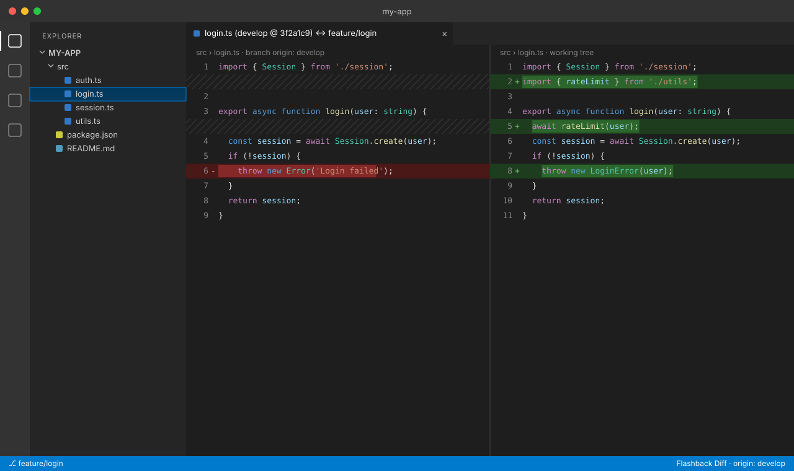
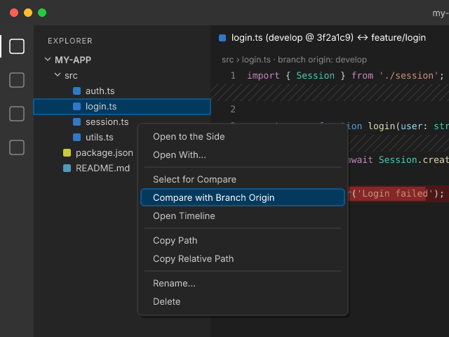

<p align="center">
  
</p>

<h1 align="center">Flashback Diff</h1>

<p align="center">
  <b>See any file as it was when your branch was born.</b><br>
  Right-click a file → diff it against the point where your branch started.
</p>

---

When you work on a feature branch, the question you usually care about is
*"what have I changed in this file since I branched off?"*. Not the last commit,
and not the current tip of `main`, which may have moved on since then.

Flashback Diff answers that with one click. It finds the commit your branch grew
from (the **merge-base** with its origin branch) and opens VS Code's native diff
editor next to your current file.



## Features

- **One click from anywhere.** Use the Explorer context menu, the editor context menu,
  the tab context menu, or the button in the editor title bar.
- **Smart origin detection.** Works out which branch you created your branch from, including
  `git checkout -b`, `git switch -c` and `git branch <name> <start>`.
- **Honest diffs.** Compares against the merge-base, so changes that landed on `main`
  after you branched don't show up as noise.
- **Edit while you compare.** The right side is your real file, with full IntelliSense,
  saving and formatting.
- **New files are handled.** Files added on your branch are compared against an empty file.
- **Zero setup.** No configuration needed. You can still override the origin when you want to.



## Usage

1. Right-click a file in the Explorer, in the editor, or on its tab.
2. Select **Compare with Branch Origin**.

The diff opens with the origin on the left and your working copy on the right:

```
login.ts (develop @ 3f2a1c9) ↔ feature/login
```

### Commands

| Command | Description |
| --- | --- |
| `Flashback Diff: Compare with Branch Origin` | Diff the current file against its branch origin. |
| `Flashback Diff: Choose Branch Origin…` | Pick the origin branch by hand. The choice is remembered per repository and branch. |
| `Flashback Diff: Reset Branch Origin Detection` | Forget manual choices and go back to automatic detection. |

## How the origin is detected

Flashback Diff tries each of these in order and stops at the first one that works:

1. **Your setting.** `flashbackDiff.baseBranch`, if set.
2. **Your choice.** A branch you picked with *Choose Branch Origin…*.
3. **Git reflog.** The record of where the branch was created
   (`branch: Created from develop`, or `checkout: moving from develop to feature/login`).
4. **Closest ancestor.** The local or remote branch whose merge-base is nearest to `HEAD`.
   Ties are broken by `flashbackDiff.preferredBranches`, then by local over remote.
5. **Ask.** If nothing else works, you get a quick pick.

> The reflog only exists on the machine where the branch was created. On a fresh clone,
> detection falls back to step 4. If it guesses wrong, choose the origin once and it is remembered.

Detection details are written to the **Flashback Diff** output channel
(*View → Output*).

## Settings

| Setting | Default | Description |
| --- | --- | --- |
| `flashbackDiff.baseBranch` | `""` | Always compare against this branch (e.g. `main`, `origin/develop`). Empty means automatic. |
| `flashbackDiff.preferredBranches` | `["main", "master", "develop", "dev"]` | Branches preferred when several candidates are equally close. |
| `flashbackDiff.showTitleButton` | `true` | Show the compare button in the editor title bar. |

## Requirements

- VS Code 1.75 or newer
- Git available on your `PATH`
- A trusted workspace (the extension runs git commands)

## Privacy and security

- **Fully local.** No network requests, no telemetry, no runtime dependencies.
- **Read-only.** Runs only read-only git commands (`rev-parse`, `reflog`, `for-each-ref`, `merge-base`, `rev-list`, `show`) and never changes your repository.
- **Trusted workspaces only.** The extension is disabled in Restricted Mode, the same way VS Code's built-in Git is.
- **No shell.** Git is called directly with argument lists, using the git binary VS Code's Git extension resolved. Branch names and settings are validated before use.

Found a vulnerability? Please report it privately through
[GitHub Security Advisories](https://github.com/vhme/flashback-diff/security/advisories/new) instead of opening a public issue.

## Contributing

Issues and pull requests are welcome.

```bash
git clone https://github.com/vhme/flashback-diff.git
cd flashback-diff
npm install
npm test        # compile + run the test suite
npm run lint
```

Press <kbd>F5</kbd> in VS Code to launch an Extension Development Host with the extension loaded.

## License

[MIT](LICENSE) © vhme
